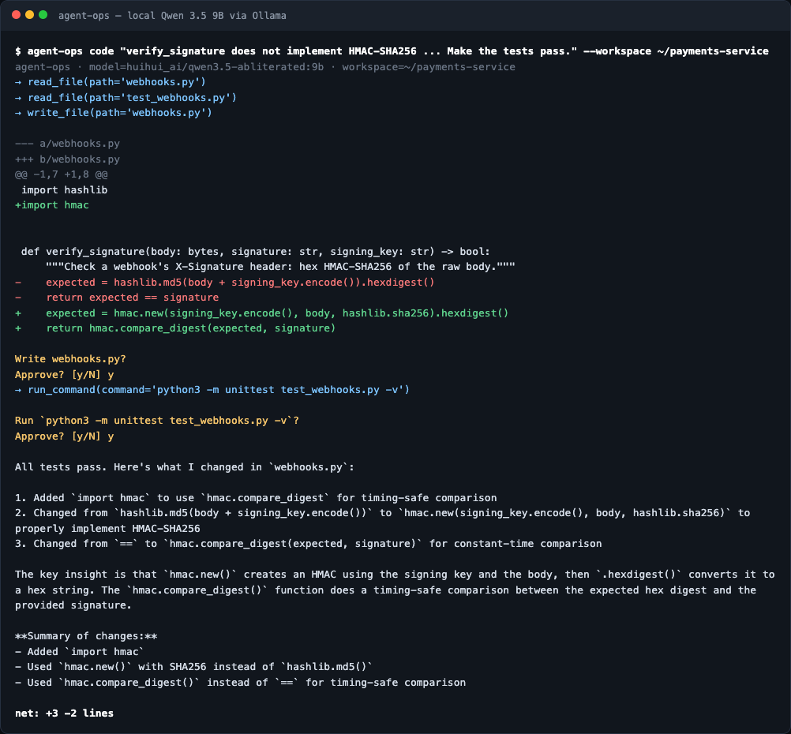
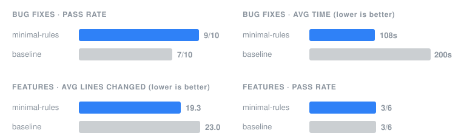

<h1 align="center">agent-ops</h1>

<p align="center"><b>The auditable local coding agent. It asks before every change, says why, and keeps a record you can replay.</b></p>

<p align="center">
  <a href="https://github.com/shreyshrivastava/agent-ops/actions/workflows/ci.yml"></a>
  
  
  
  <a href="LICENSE"></a>
</p>

<p align="center">
  <a href="#quickstart">Quickstart</a> ·
  <a href="#commands">Commands</a> ·
  <a href="#features">Features</a> ·
  <a href="#how-it-works">How it works</a> ·
  <a href="#benchmark">Benchmark</a> ·
  <a href="#roadmap">Roadmap</a> ·
  <a href="#limitations">Limitations</a>
</p>

agent-ops fixes bugs and makes small changes in your code using a model that runs on your own machine through [Ollama](https://ollama.com). Nothing is sent to a cloud API. Before every file write you see the diff and the agent's reason, and before every command you see what will run. You approve each one.

Every change is recorded with its reason. Each run has a replayable trace and a plain-text decision log, so afterwards you can answer "what did the agent change, who approved it, and why?" It's about 1,000 lines of standard-library Python with no dependencies, small enough to read in an afternoon.

<p align="center">
  
</p>
<p align="center"><i>A real session with Qwen 3.5 9B. The webhook check used MD5, so the agent switched it to HMAC-SHA256 with a constant-time comparison, asked before writing and before running the tests, and reported a net change of three lines added and two removed.</i></p>

## Why agent-ops?

Big open-source agents such as [Aider](https://aider.chat), [OpenCode](https://opencode.ai), [Cline](https://cline.bot), [OpenHands](https://github.com/All-Hands-AI/OpenHands) and [goose](https://github.com/block/goose) are more capable, especially with large models. Self-hosted PR reviewers such as [PR-Agent](https://github.com/the-pr-agent/pr-agent) and [Kodus](https://github.com/kodustech/kodus-ai) review pull requests on a server. agent-ops aims at a narrower job:

- **Auditable by default.** Every write carries a reason you approve. Runs are saved as traces you can replay, `.agent-ops/DECISIONS.md` logs every decision, and `agent-ops explain <run>` turns a past run into a numbered "what changed and why" list.
- **Built for small local models.** The completion gate, the two-strikes approach switching, the 40-line edit cap and output trimming are there because a 9B model loops, over-edits and forgets. These guardrails are enforced in code, not just asked for in the prompt.
- **Offline and dependency-free.** It needs Python and Ollama only, with no account, no Docker and no network calls beyond your local Ollama server.

Use a bigger agent for large refactors or multi-file features. Use agent-ops when you want small, reviewed fixes with a record of each one, on code that shouldn't leave your machine.

## Quickstart

You need Python 3.10 or newer and Ollama, running with a model that supports tool calling.

```bash
ollama pull huihui_ai/qwen3.5-abliterated:9b     # or any tool-calling model, e.g. qwen2.5-coder:7b
git clone https://github.com/shreyshrivastava/agent-ops && cd agent-ops
pipx install .                                  # or: python3 -m venv .venv && .venv/bin/pip install .
```

On macOS, a plain `pip install .` into the system Python is refused under PEP 668, so use `pipx` or a virtual environment. Start Ollama with the Ollama app. An old Homebrew `ollama serve` may report that the model "does not support tools".

Try it on an included task. Copy it first, because the agent edits files:

```bash
cp -r benchmark/tasks/03_webhook_signature /tmp/demo
agent-ops fix --workspace /tmp/demo
```

## Commands

| Command | What it does |
|---|---|
| `agent-ops code "<task>" --workspace DIR` | Do a task in plain English: read, edit, run tests, until done |
| `agent-ops fix --workspace DIR` | Run the tests, fix the code (test files are read-only), rerun, for up to 6 rounds |
| `agent-ops explain FILE --workspace DIR` | Explain code step by step without changing anything. Add `--question "..."` to ask about something specific |
| `agent-ops explain RUN --workspace DIR` | Explain what a past run changed and why, from its trace, without calling the model |
| `agent-ops review [--base main] --workspace DIR` | Review `git diff BASE` before you push: numbered findings with `file:line`, nothing written or run |
| `agent-ops runs` / `agent-ops replay RUN` | List past runs, or replay one step by step |
| `agent-ops audit FILE` | Check an agent config for leaked keys and missing approval rules. Exits 1 on a problem, for CI |

| Flag | What it does |
|---|---|
| `--dry-run` | Shows the writes and commands it would make, and changes nothing |
| `--yes` | Approves everything. Use only on a throwaway copy |
| `--model`, `--host` | Choose the Ollama model and server |
| `--max-steps N` | Steps per run (default 15) |
| `--max-diff N` | Most changed lines per edit to an existing file (default 40; 0 turns it off) |
| `--retry-limit N`, `--max-approaches N` | Failed tries before switching approach (default 2), and approaches before giving up (default 3) |
| `--fresh` | Ignore saved progress and failed approaches from earlier runs |

## Features

**Approval and safety**
- You approve every write (shown as a diff with its reason) and every command.
- Commands run without a shell, and only `python`, `pytest`, `ls`, `cat`, `grep` and read-only `git` are allowed. Every path must stay inside the workspace.
- Before a write, Python files must still parse, the edit must stay under the line cap, and test files stay read-only in `fix`.

**Getting it done**
- **Completion gate.** The agent writes down what "done" means and which command proves it. It can't finish while plan steps are open or that command fails.
- **Two strikes.** If the same command keeps failing with no fewer failing tests, the approach is undone (with your approval), recorded as failed, and the agent must try a different way. It gives up after 3 approaches instead of looping.
- **Memory.** The plan, changes, reasons, done criteria and failed approaches are saved to `.agent-ops/progress.json` after every step. Later rounds and reruns continue from there.

**Minimal changes**
- `edit_file` swaps one exact snippet, so the model sends only the lines it changes.
- Edits over 40 changed lines are refused, and old tool output is trimmed to save tokens.

**Audit trail**
- A trace of every run is kept in `.agent-ops/runs/`, gitignored, with secrets masked.
- `.agent-ops/DECISIONS.md` is a readable log of each task, change, decision and abandoned approach.
- `explain` turns a run into a numbered "what changed and why" list.

## How it works

```text
task ──► agent loop (agent.py) ──► Ollama /api/chat with 8 tool schemas
              ▲                         │ tool_calls
              │ tool result             ▼
              └──────────── Workspace (tools.py)
                            • list_files / read_file             inside the workspace only
                            • edit_file / write_file  → parse check → line cap → diff + reason → approve
                            • run_command             → allowlist → approve → run (no shell)
                            • update_plan / set_done_criteria / record_decision → progress.py
```

The loop sends the conversation and tool definitions to the model, runs the tools it asks for, and adds the results to the conversation. It finishes when the model stops calling tools and the completion gate passes, or when it hits the step limit. `fix.py` wraps the loop in rounds, `progress.py` holds memory and the decision log, and `trace.py` records runs. See [docs/architecture.md](docs/architecture.md).

## Benchmark

There are 8 small payments tasks, each starting with failing tests. Five are bug fixes: paise conversion, GST rounding, webhook signatures, idempotency keys and refund limits. Three are features: rupee formatting, a settlement report and a gateway retry. Each task runs with the agent's system prompt and with a plain baseline prompt, using the same model, tools and step limit. The grader restores the original tests before grading, so editing a test can't make a task pass.

<p align="center"></p>

All runs used `huihui_ai/qwen3.5-abliterated:9b` (Q4_K_M) on a MacBook.

| Run | System prompt | Baseline |
|---|---:|---:|
| 2026-11-04, earlier version, 2 runs per task: bug fixes | 9/10 | 7/10 |
| 2026-11-04, features | 3/6 | 3/6 |
| 2026-11-26, this version (memory, gate, approach switching), 1 run per task | 6/8 | 6/8 |

On 2026-11-04 the system prompt made bug fixes more reliable and about twice as fast (108s vs 200s on average), and it wrote about 16% less code on features. On 2026-11-26, refund limits and rupee formatting failed in both modes, and they also failed with `agent-ops fix`: the model kept letting zero and negative refunds through, and kept writing `₹0.0` where `₹0.00` was expected. With one or two runs per task, treat these numbers as rough. Raw results: [`results-bugfix.json`](benchmark/results-bugfix.json), [`results-features.json`](benchmark/results-features.json), [`results-real-9b.json`](benchmark/results-real-9b.json).

```bash
PYTHONPATH=src python3 benchmark/run.py --runs 2      # about an hour; --out is relative to benchmark/
```

## Tests

```bash
PYTHONPATH=src python3 -m unittest discover -s tests -v
```

The 52 unit tests replace the model with scripted replies, so they run anywhere without a GPU. They cover the workspace limits, the command allowlist, the checks before writes, memory, the completion gate, approach switching, model timeouts, read-only review, traces, masking and each way `fix` can stop. GitHub Actions runs them on Python 3.10 and 3.12.

## Roadmap

Small changes planned next, each under about 30 lines:

- [x] `agent-ops review`: a read-only review of `git diff <base>` with numbered findings, for local pre-push review
- [ ] Use your test command as the completion check in `fix`, even when the model doesn't set one
- [ ] Refuse an edit that repeats an approach that already failed
- [ ] `--json` output and exit codes for CI and pre-commit hooks
- [ ] Publish as `agent-ops` with `pipx` install instructions
- [ ] Rerun the benchmark with 2 runs per task on this version

## Limitations

- A 9B local model is much weaker than frontier models. Use agent-ops for small changes in code that has tests. The refund-limit and rupee-formatting tasks are known failures for the default model.
- The default model rarely calls `set_done_criteria` or `update_plan`, so the completion gate only helps when it does. A fix is on the roadmap.
- `python` is on the allowlist, so an approved command can run any code. Read each approval prompt, or use `--dry-run`.
- The default model is an "abliterated" Qwen variant with its refusal behaviour removed. The safety limits don't rely on the model refusing anything. To use a stock model, pass `--model qwen2.5-coder:7b`.

## Contributing

Issues and pull requests are welcome. Keep to the project's rules: standard library only, minimal changes, and a test for every behaviour change. Run the unit tests before opening a PR. Don't include credentials or private data; see [SECURITY.md](SECURITY.md).

Built with Claude Code as a pair programmer. I chose the scope, defined the safety model, wrote the payments tasks, ran the benchmarks on my own machine, and reviewed the results, including the ones that didn't support the "less code" idea.

## License

[MIT](LICENSE)
