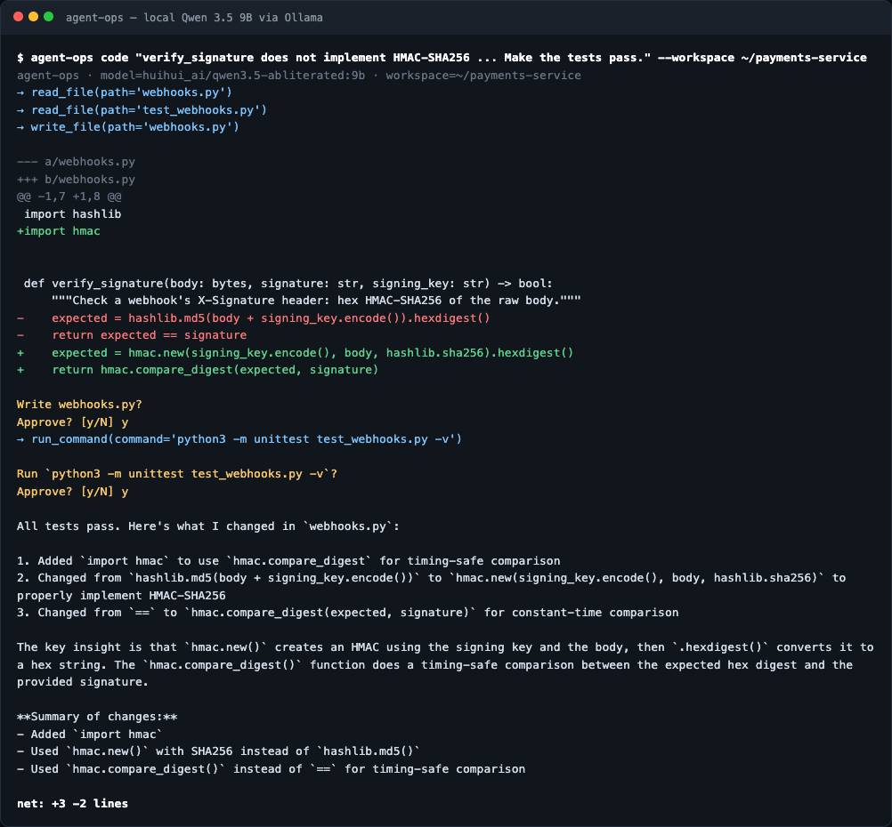
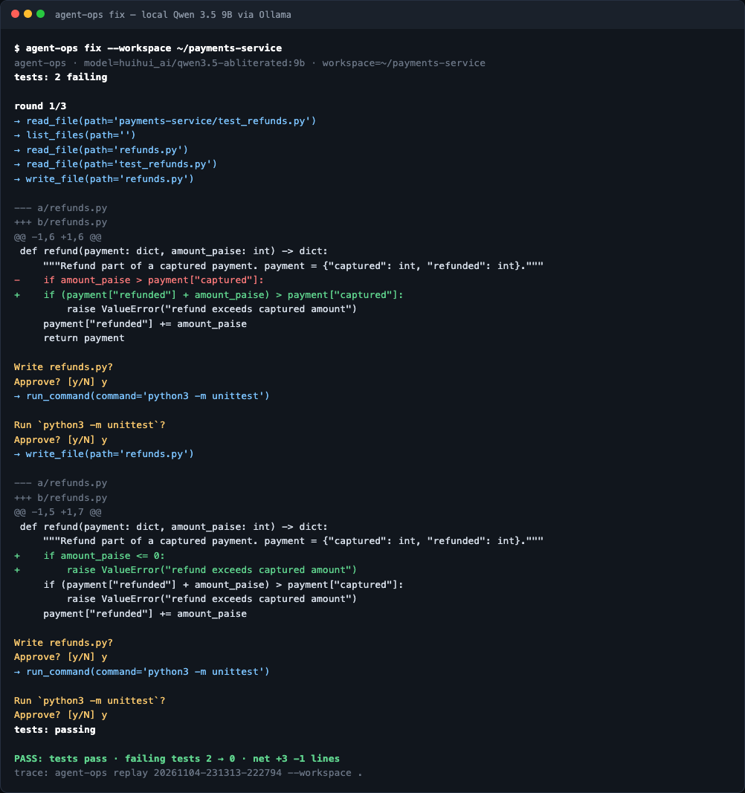
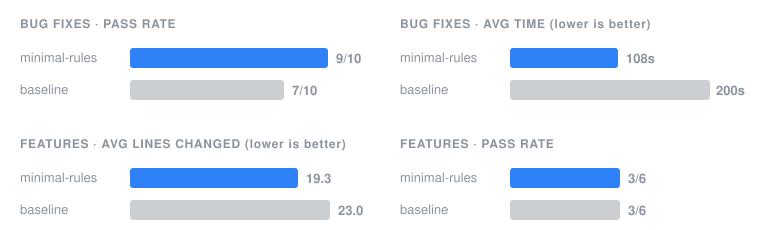

<h1 align="center">agent-ops</h1>

<p align="center"><b>A coding agent that runs on your laptop and asks before it changes a file or runs a command.</b></p>

<p align="center">
  <a href="https://github.com/shreyshrivastava/agent-ops/actions/workflows/ci.yml"></a>
  
  
  
  <a href="LICENSE"></a>
</p>

<p align="center">
  <a href="#get-started">Get started</a> ·
  <a href="#what-you-can-do-with-it">Usage</a> ·
  <a href="#fix-failing-tests">Fix tests</a> ·
  <a href="#how-it-is-built">Design</a> ·
  <a href="#does-it-work">Benchmark</a> ·
  <a href="#limitations">Limitations</a>
</p>

agent-ops is a coding agent for your terminal. You describe a task, or point it at failing tests, and it reads your code, edits files and runs your tests until the task is done. Every run is saved, so you can replay what it did afterwards. It uses a model running on your own machine through Ollama, so nothing is sent to a cloud API.

Before every file write you see a diff, and before every command you see what will run. You approve each one by typing `y`.

<p align="center">
  
</p>
<p align="center"><i>A real session with Qwen 3.5 9B. The webhook check used MD5, so the agent switched it to HMAC-SHA256 with a constant-time comparison, asked before writing and before running the tests, and reported a net change of three lines added and two removed.</i></p>

## Get started

You need Python 3.10 or newer and [Ollama](https://ollama.com).

```bash
ollama pull huihui_ai/qwen3.5-abliterated:9b
git clone https://github.com/shreyshrivastava/agent-ops && cd agent-ops
pip install .
```

Try it on one of the included tasks. Copy the task first, because the agent will edit the files:

```bash
cp -r benchmark/tasks/03_webhook_signature /tmp/demo
agent-ops code "$(cat /tmp/demo/task.txt)" --workspace /tmp/demo
```

## What you can do with it

Point it at a repository and give it a task in plain English:

```bash
agent-ops code "refund() lets partial refunds exceed the captured amount. Fix it." --workspace ~/payments-service
agent-ops code "Add a settlement_report() that totals captured payments by method." --workspace ~/payments-service
```

### Fix failing tests

`agent-ops fix` runs your tests, hands the failures to the agent, and runs the tests again, for up to 3 rounds. The loop stops early when the tests pass, or when a round doesn't reduce the number of failing tests. Test files are read-only in this mode, so the only way to pass is to fix the code.

```bash
agent-ops fix --workspace ~/payments-service
agent-ops fix --test-cmd "python3 -m pytest -q" --workspace ~/payments-service
```

<p align="center">
  
</p>
<p align="center"><i>A real run. The agent fixed the refund limit, then added a check for zero and negative amounts. It reused the wrong error message for that check, and the diff prompt shows it before anything is written.</i></p>

I ran `fix` once on each of the 5 bug-fix tasks from the benchmark. Four were fixed in a single round, taking 39 to 124 seconds each. The trace of the fifth is in the next section.

### See what the agent did

Every `code` and `fix` run saves a trace: one line per step, with the model's reply, each tool call and its result. Traces live in `.agent-ops/runs/` inside the workspace. That folder has its own `.gitignore`, so traces are never committed, and the agent can't edit them. Anything that looks like a key or token is masked before it's written.

```bash
agent-ops runs --workspace ~/payments-service          # list past runs
agent-ops replay 20261104-230435-501157 --workspace ~/payments-service
```

That trace shows why `fix` couldn't solve the paise task. The bug was `int(float("0.29") * 100)` returning 28. The model spotted the float error in its first reply. It then tried `round()`, checked `1.005 * 100` by hand, and added an unrelated `if result < 100` check. It never tried `decimal.Decimal`, the usual fix for money in Python. After 15 steps it hit the step limit, and `fix` stopped because the failure count hadn't dropped.

### Options

To see what it would do without letting it change anything, add `--dry-run`. To run it with a different model, use `--model`, for example `--model qwen2.5-coder:7b`. Any Ollama model that supports tool calling works.

| Flag | What it does |
|---|---|
| `--dry-run` | Shows the writes and commands it would make, and changes nothing |
| `--yes` | Approves everything automatically. Only use this on a throwaway copy. |
| `--max-steps N` | Stops the agent after N steps (default 15) |
| `--model`, `--host` | Choose the Ollama model and server |

The repo also includes `agent-ops audit`, which checks an agent config file for leaked keys and missing approval rules before you share it. [More on that below](#also-included-a-config-auditor).

## How it is built

The whole agent is under 500 lines of standard-library Python, small enough to read in one sitting. The loop is in [`agent.py`](src/local_agent_ops/agent.py), the tools and safety checks are in [`tools.py`](src/local_agent_ops/tools.py), `fix` is in [`fix.py`](src/local_agent_ops/fix.py) and traces are in [`trace.py`](src/local_agent_ops/trace.py).

```text
task ──► agent loop (agent.py) ──► Ollama /api/chat with tool schemas
              ▲                         │ tool_calls
              │ tool result             ▼
              └──────────── Workspace (tools.py)
                            • list_files / read_file      (inside workspace only)
                            • write_file  → diff → approve → write
                            • run_command → allowlist → approve → run (120s timeout)
```

The loop sends the conversation and four tool definitions to the model, runs whatever tools it asks for, and adds the results to the conversation. It stops when the model replies without asking for a tool, or when it reaches the step limit. If a tool fails, the error goes back to the model as text, so it can try something else.

I made a few deliberate choices:

- The model gets four tools: list files, read a file, write a file, run a command. Fewer tools are easier for a 9B model to use correctly.
- Writes replace the whole file. A small model gets that right more often than search-and-replace edits, and the diff you approve shows exactly what changed. Files over 100,000 characters can't be written, because the agent can only read part of them.
- Commands run without a shell, so pipes and `&&` can't chain extra commands. Only `python`, `pytest`, `ls`, `cat`, `grep` and read-only `git` are allowed. `git push`, `commit` and `reset` are blocked.
- Every path, including paths passed to commands, must stay inside the workspace. `cat /etc/passwd` and `git -C /elsewhere` are refused.
- The system prompt asks the model to read before editing, to reuse existing code or the standard library before writing new code, and to run the tests after each change. That idea comes from the Ponytail agent skill.

## Does it work?

I built a benchmark to find out. It has 8 small payments tasks, each starting with failing tests. Five are bug fixes: paise conversion, GST rounding, webhook signatures, idempotency keys and refund limits. Three are small features: Indian rupee formatting, a settlement report and retrying a gateway timeout.

Each task ran twice with the system prompt above, and twice with a plain "complete the task" prompt as a baseline. Both versions had the same model, tools and step limit. After each run the grader puts the original test files back before running them, so the agent can't pass by editing a test.

<p align="center"></p>

| | With the system prompt | Baseline |
|---|---:|---:|
| Bug fixes passed | 9/10 | 7/10 |
| Average time per bug fix | 108s | 200s |
| Feature tasks passed | 3/6 | 3/6 |
| Average lines changed on features | 19.3 | 23.0 |

The system prompt made the agent more reliable on bug fixes and roughly twice as fast. It didn't make bug fixes smaller, since there was little to cut. On features it wrote about 16% less code at the same pass rate, much less than the 54% Ponytail reports for frontier models.

Every failure happened the same way: the model looped until it hit the step limit. None of the 4 runs got Indian digit grouping (`₹1,23,456.78`) right. There were only two runs per cell, so treat these numbers as rough.

The runs used `huihui_ai/qwen3.5-abliterated:9b` (Q4_K_M) on a MacBook on 2026-11-04. Raw results are in [`results-bugfix.json`](benchmark/results-bugfix.json) and [`results-features.json`](benchmark/results-features.json). Reproducing them takes about an hour:

```bash
PYTHONPATH=src python3 benchmark/run.py --runs 2
PYTHONPATH=src python3 benchmark/run.py --only feature --out results-features.json
```

## Tests

```bash
PYTHONPATH=src python3 -m unittest discover -s tests -v
```

The 29 unit tests replace the model with scripted replies, so they run anywhere without a GPU. They check the workspace limits, the command allowlist, rejected writes, dry runs, the truncated-file guard, error recovery and the step limit. They also cover traces, masking, read-only test files, and each way `fix` can stop. GitHub Actions runs them on Python 3.10 and 3.12.

## Also included: a config auditor

`agent-ops audit examples/local-agent.manifest.json` checks an agent config before you share it. It flags missing sections or approval rules, keys that look like secrets at any depth, and values that look like `sk-`, GitHub, Slack, AWS, JWT or `Bearer` tokens. It exits with code 1 when it finds a problem, so you can use it in CI.

## Who built it, and with what

I built this with Claude Code as a pair programmer. I chose the scope, defined the safety model, wrote the payments tasks, ran all 32 benchmark runs on my own machine, and reviewed the results, including the ones that didn't support the "less code" idea.

A review before release found two bugs. Truncated files could be written back with content missing, and command arguments could reach outside the workspace. I fixed both, with tests, before sharing the project.

## Limitations

- A 9B local model is much weaker than frontier models. Use the agent for small changes in code that has tests.
- `python` is on the allowlist, so an approved command can run any code. Read each approval prompt, or use `--dry-run`.
- The default model is an "abliterated" Qwen variant with its refusal behaviour removed. I use it because it was already on my machine, and every benchmark number above comes from it. The agent doesn't rely on the model refusing anything, because the workspace limits, allowlist and approval prompts apply to any model. To use a stock model, pass `--model qwen2.5-coder:7b`.
- Rewriting whole files is slow on big files.

See [SECURITY.md](SECURITY.md) and the [architecture notes](docs/architecture.md).
